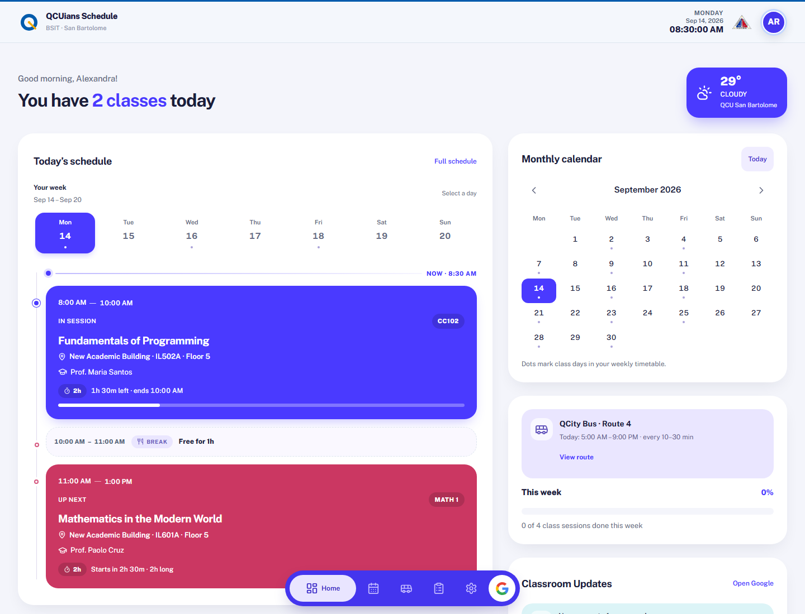
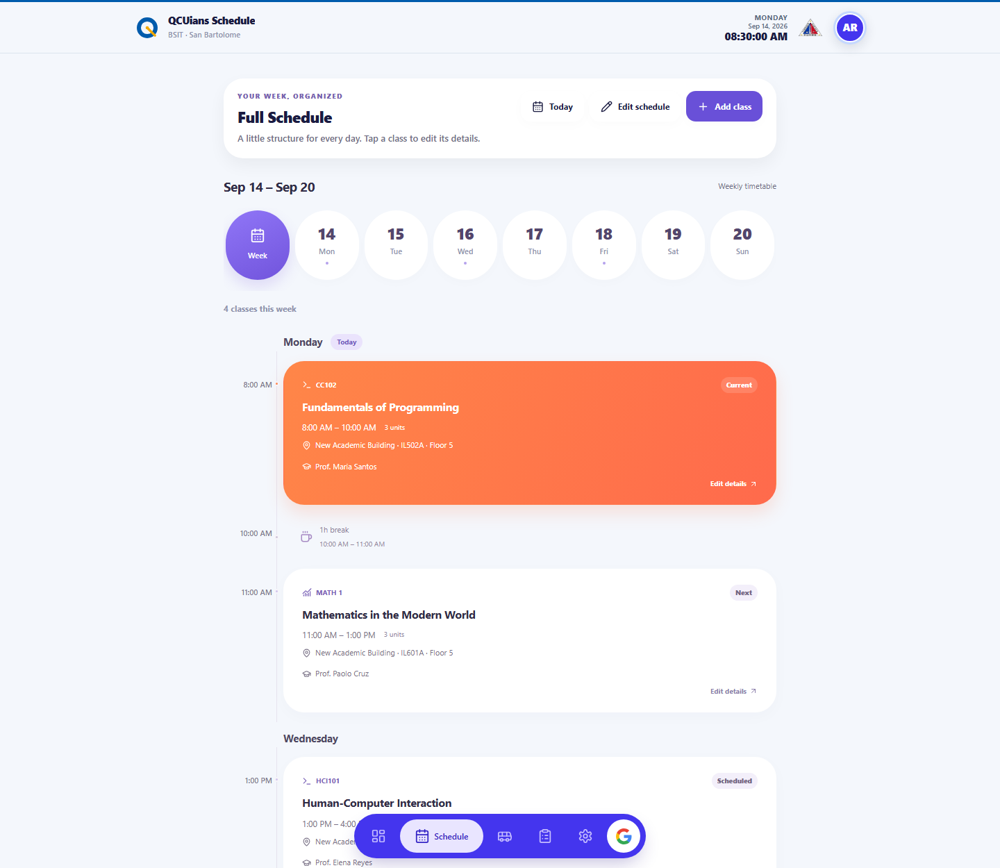
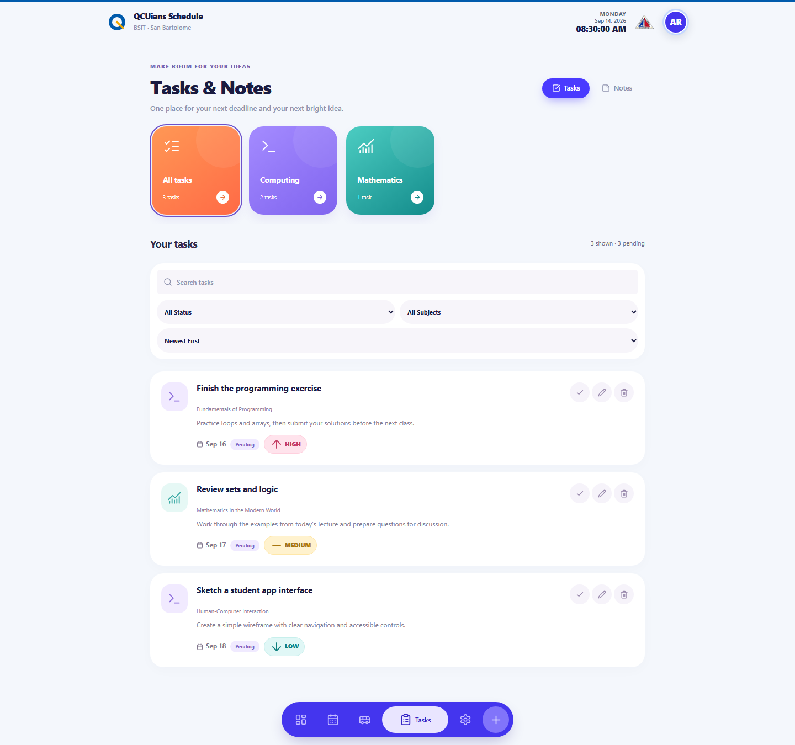
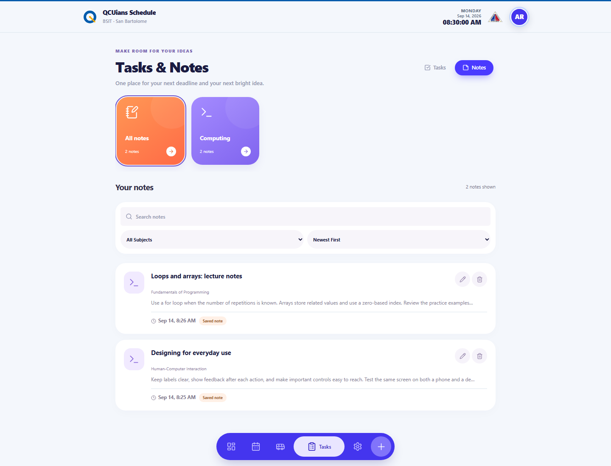
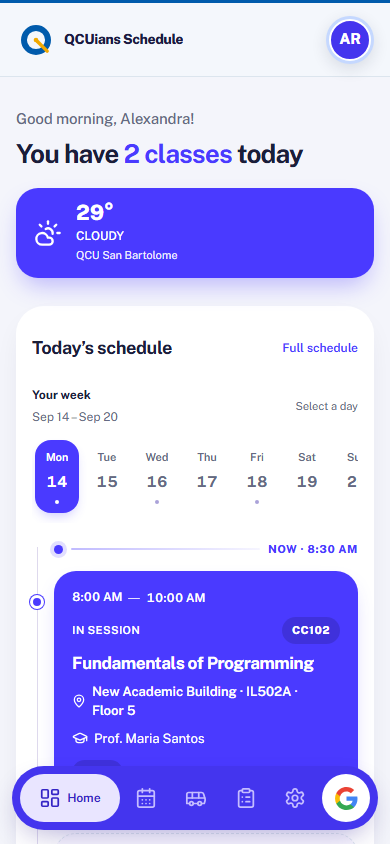
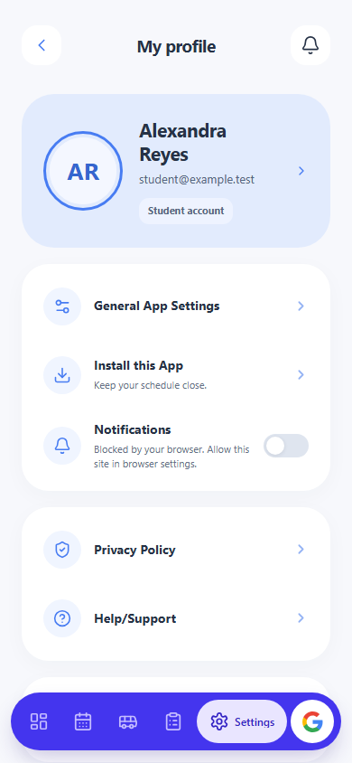
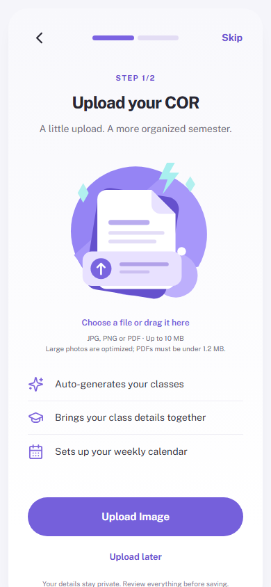

<p align="center">
  
</p>

<h1 align="center">QCU Schedule</h1>

<p align="center">
  Your classes, tasks, and campus day, all in one place.<br>
  A student planner for Quezon City University, also known as <strong>My-Schedule</strong>.
</p>

<p align="center">
  
  
  
  
</p>

<p align="center">
  <a href="https://qcu-schedule-web-app.pages.dev"><strong>Open the app</strong></a>
  &nbsp;&middot;&nbsp;
  <a href="#screenshots">Screenshots</a>
  &nbsp;&middot;&nbsp;
  <a href="#getting-started">Getting started</a>
  &nbsp;&middot;&nbsp;
  <a href="#documentation">Documentation</a>
</p>



QCU Schedule helps students turn a Certificate of Registration (COR) into a weekly timetable, see which class is happening now, and keep coursework organized. The responsive interface brings together class locations, professors, tasks, notes, Google Classroom updates, and campus commute information.

## Contents

- [Features](#features)
- [Screenshots](#screenshots)
- [Student workflow](#student-workflow)
- [Technology](#technology)
- [Getting started](#getting-started)
- [Configuration](#configuration)
- [Google Sheets setup](#google-sheets-setup)
- [Development commands](#development-commands)
- [Deployment](#deployment)
- [Project structure](#project-structure)
- [Documentation](#documentation)

## Features

| Feature | What you can do |
| --- | --- |
| **Daily dashboard** | See current and upcoming classes, breaks, a monthly calendar, and progress through the week. |
| **COR import** | Upload a registration document, review extracted student and class details, and confirm your timetable. |
| **Schedule management** | Filter by day and add, edit, or remove class meetings, including times, rooms, buildings, and professors. |
| **Tasks and notes** | Organize coursework by subject, search your workspace, set priorities and deadlines, and track completion. |
| **Google Classroom** | Connect from Settings to view course updates and manage synchronization preferences. Gmail metadata access is optional and requested separately. |
| **Campus information** | Browse buildings and rooms, view QCity Bus Route 4, and check weather and available flood or class-suspension advisories. |
| **Account settings** | View your profile, manage browser notifications, install the app, and sign out. |
| **Administrator tools** | Authorized administrators can manage student accounts and inspect account details. |
| **Installable app** | Use a standalone PWA with cached app assets, an offline fallback, and cached Google update cards. |

Signing in, importing a COR, saving changes, and fetching fresh updates require a network connection. Browser notification alerts operate while the app is open, subject to browser support and permission.

## Screenshots

These screenshots show the actual application rendered locally with fictional student data and a fixed sample date. The mobile images use a 390-pixel viewport; desktop images use a 1440-pixel viewport.

### Desktop workspace

| Weekly schedule | Tasks |
| --- | --- |
|  |  |

<details>
<summary><strong>View the notes workspace</strong></summary>



</details>

### On your phone

| Today's classes | Profile and settings | COR upload |
| --- | --- | --- |
|  |  |  |

To refresh the screenshots after a UI change, install the browser once and run the capture script:

```bash
npx playwright install chromium
node scripts/capture-readme-screenshots.mjs
```

The script writes seven PNGs to `docs/screenshots/`. It serves the local frontend and supplies sample API responses without using your `.dev.vars` credentials or contacting external services.

## Student workflow

1. **Sign in with Google** to access your student account.
2. **Upload your COR** and review the extracted information before confirming it.
3. **Open Home** to see today's classes and the next meeting.
4. **Use Schedule** to browse the week or update a class.
5. **Use Tasks & Notes** to keep assignments and lecture notes together.
6. **Connect Google Classroom from Settings** when you want course updates, or open QC Bus to plan your campus trip.

## Technology

| Layer | Tools |
| --- | --- |
| Frontend | HTML, CSS, vanilla JavaScript, Tailwind CSS for compiled entry styles, and Lucide icons |
| App shell | Web app manifest, service worker, and browser data caches |
| API | Cloudflare Pages Functions under `functions/api/` |
| Authentication and integrations | Google OAuth, Google Classroom API, and optional Gmail metadata access |
| Persistence | Google Sheets through a signed Google Apps Script web app |
| COR processing | Gemini extraction and Tesseract.js OCR support |
| Maps and weather | MapLibre GL, OpenFreeMap, and Open-Meteo |
| Development and verification | Node.js, Wrangler, and Playwright |

The browser calls the Pages Functions API for student data. The API signs persistence requests to the Apps Script web app, which reads and writes the Google Sheets workbook. Google authorization tokens are encrypted into HttpOnly cookies; frontend code receives normalized integration results.

## Getting started

### Requirements

- **Node.js 22 or newer** and npm. Node.js 24 LTS is a suitable choice.
- A modern browser.
- Google OAuth credentials for real sign-in.
- A Google Sheets workbook and Apps Script deployment for persistent student accounts.
- A Gemini API key when testing AI-powered COR extraction.

### Run locally

```bash
git clone https://github.com/TsmHabib03/QCU-Schedule-Web-App.git
cd QCU-Schedule-Web-App
npm ci
```

Copy the example environment file. In PowerShell:

```powershell
Copy-Item .dev.vars.example .dev.vars
```

On macOS or Linux:

```bash
cp .dev.vars.example .dev.vars
```

Replace the example values with your own configuration, including your own Apps Script deployment URL, then start the project server:

```bash
npm run dev
```

Open **http://127.0.0.1:8788**. The project server serves both the frontend and API handlers. For checks in the Cloudflare Pages local runtime, use `npm run dev:wrangler` at **http://127.0.0.1:8790**.

The server can start without a complete external configuration so you can inspect the entry screen. Real sign-in and persistent account workflows require the services below. The in-memory fallback is for isolated development and does not provide durable production storage.

## Configuration

Local configuration lives in `.dev.vars`, which is ignored by Git. Set production values in **Cloudflare Pages → Settings → Environment variables** and create a new deployment after changing them.

| Variable | Purpose |
| --- | --- |
| `GOOGLE_CLIENT_ID` | Google OAuth Web application client ID. |
| `GOOGLE_CLIENT_SECRET` | Google OAuth client secret. |
| `GOOGLE_SESSION_SECRET` | Random secret of at least 32 characters for encrypted session cookies. |
| `GOOGLE_PUBLIC_ORIGIN` | Canonical production origin, such as `https://qcu-schedule-web-app.pages.dev`. Leave empty locally to use the request origin. |
| `APPS_SCRIPT_URL` | Your deployed Google Apps Script web app URL ending in `/exec`. |
| `APPS_SCRIPT_SECRET` | Shared secret used to sign database requests; must match the Apps Script property. |
| `GEMINI_API_KEY` | API key for AI-powered COR extraction. Add this to `.dev.vars` when needed. |
| `ADMIN_GOOGLE_SUB` | Optional additional restriction to the approved administrator's stable Google account ID. |

Store secret values as encrypted Cloudflare variables. Keep credentials in server configuration.

### Google OAuth callbacks

Create an OAuth **Web application** client and register both callback paths for each origin you use:

```text
http://127.0.0.1:8788/api/auth/google/callback
http://127.0.0.1:8788/api/google/callback

https://qcu-schedule-web-app.pages.dev/api/auth/google/callback
https://qcu-schedule-web-app.pages.dev/api/google/callback
```

Add the matching `http://127.0.0.1:8790` callbacks when using Wrangler locally. Use your canonical hostname for a custom domain. Google requires exact callback matches, including hostname, port, and path.

Enable the Google Classroom API for course integration and the Gmail API if you enable the optional Gmail feature. Sign-in and Classroom connection use separate authorization flows. See [Authentication](docs/architecture/AUTHENTICATION.md) and [Google integration](docs/guides/GOOGLE_INTEGRATION.md) for details.

## Google Sheets setup

1. Create your database workbook and open **Extensions → Apps Script**.
2. Add the contents of [setup-database.gs](setup-database.gs) to the script project.
3. Run `setupDatabase()` and `seedCatalogData()` and grant the script owner's required permissions.
4. Set `APPS_SCRIPT_SECRET` in **Project Settings → Script properties**.
5. Deploy a **Web app** with **Execute as: Me** and **Who has access: Anyone**. Database requests are authenticated by their server signature.
6. Put the deployment `/exec` URL and matching shared secret in `.dev.vars` or your Cloudflare environment.

Visit `/api/v1/health` to check configuration presence. `persistence: "sheets"` means the Sheets variables are set; verify the connection by saving and reloading a normal account change. The health endpoint does not perform a database round trip.

For schema updates and publishing a new Apps Script version, follow [Deployment infrastructure](docs/guides/DEPLOYMENT_INFRASTRUCTURE.md) and [Administrator setup](docs/guides/ADMIN_DASHBOARD_SETUP.md).

## Development commands

| Command | Purpose |
| --- | --- |
| `npm run dev` | Serve the frontend and API locally on port 8788. |
| `npm run dev:wrangler` | Run the local Cloudflare Pages runtime on port 8790. |
| `npm run build` | Compile entry CSS, generate asset fingerprints and the service-worker manifest, and stage public files. |
| `npm run watch:css` | Recompile entry styles as they change. |
| `npm run check:project` | Check documentation links, app assets, and build contents. |
| `npm run test:student` | Check responsive student pages, navigation, settings, and UI states with browser fixtures. |
| `npm run test:google` | Check Google connection behavior and OAuth handling. |
| `npm run test:bus` | Check the Route 4 interface and map rendering. |
| `npm run test:feedback` | Check dialogs, focus management, and notification feedback. |
| `npm run test:cor` | Check COR extraction, processing jobs, and loading behavior. |
| `npm run test:schedule` | Check day/time handling and schedule mutations. |
| `npm run test:accounts` | Check account access and active schedule selection. |
| `npm run test:admin` | Check administrator security, APIs, and workflows. |
| `npm run sheets:test-mapping` | Check Sheets schema mappings and time cells. |

Browser suites require `npx playwright install chromium` once. The bus suite may download MapLibre fixture assets on its first run. Additional commands are listed in [package.json](package.json).

On Windows, use `npm.cmd` or `npx.cmd` if PowerShell blocks the corresponding `.ps1` launcher.

## Deployment

Cloudflare Pages serves the staged frontend and compiles `functions/` into the same deployment.

| Setting | Value |
| --- | --- |
| Pages project | `qcu-schedule-web-app` |
| Production branch | `main` |
| Build command | `npm run build` |
| Build output directory | `.build/pages` |
| Runtime configuration | [wrangler.toml](wrangler.toml) and Cloudflare environment variables |

For a manual production deployment after configuring the project and reviewing your changes:

```bash
npx wrangler login
npm run deploy -- --branch main
```

The `predeploy` script runs the build automatically. Use the Pages deployment command; this repository is configured as a Pages project. Apps Script updates must be published separately through its deployment editor.

See [UI deployment](docs/guides/UI_DEPLOYMENT.md) for current publishing steps, [Deployment infrastructure](docs/guides/DEPLOYMENT_INFRASTRUCTURE.md) for the broader design, and [Administrator setup](docs/guides/ADMIN_DASHBOARD_SETUP.md) for account and database configuration.

## Project structure

```text
QCU-Schedule-Web-App/
├── index.html                  # Google sign-in and student dashboard
├── onboarding.html             # COR upload and review
├── schedule.html               # Weekly timetable and class editing
├── workspace.html              # Tasks and notes
├── campus-eta.html             # Campus commute and QCity Bus Route 4
├── buildings.html              # Campus building directory
├── settings.html               # Profile, Google connection, and preferences
├── admin.html                  # Protected account management
├── assets/                     # Styles, browser scripts, and images
├── data/                       # Academic catalog and campus/advisory datasets
├── functions/                  # Cloudflare Pages middleware and API handlers
├── scripts/                    # Local server, builds, checks, and screenshot capture
├── docs/                       # Documentation index, guides, and screenshots
│   ├── architecture/           # System and data design
│   ├── guides/                 # Setup, integrations, and deployment
│   ├── verification/           # Regression and release reports
│   ├── design/                 # Brand source files and UI mockups
│   ├── archive/                # Historical plans and reviews
│   └── screenshots/            # Desktop and mobile app screenshots
├── setup-database.gs           # Google Apps Script database backend
├── manifest.json               # PWA metadata
├── service-worker.js           # Generated offline app shell
└── wrangler.toml               # Cloudflare Pages configuration
```

## Documentation

Browse the [documentation index](docs/README.md) for all guides, verification reports, and design assets. Historical plans and reviews are kept in `docs/archive/`. Builds, logs, and local scratch files are ignored by Git.

| Guide | Coverage |
| --- | --- |
| [Architecture](docs/architecture/ARCHITECTURE.md) | Overall system design and component responsibilities. |
| [Authentication](docs/architecture/AUTHENTICATION.md) | Google sign-in, sessions, and account routing. |
| [Database](docs/architecture/DATABASE.md) | Data models and persistence design. |
| [COR pipeline](docs/guides/COR_AI_PIPELINE.md) | Registration extraction and review flow. |
| [COR reliability](docs/verification/COR_RELIABILITY_VERIFICATION.md) | Processing checks and persistence requirements. |
| [Google integration](docs/guides/GOOGLE_INTEGRATION.md) | Classroom connection and optional Gmail authorization. |
| [Administrator setup](docs/guides/ADMIN_DASHBOARD_SETUP.md) | Administrator access and database setup. |
| [Deployment infrastructure](docs/guides/DEPLOYMENT_INFRASTRUCTURE.md) | Hosting, configuration, and publishing the app. |
| [UI deployment](docs/guides/UI_DEPLOYMENT.md) | Current frontend, Functions, and Apps Script publishing steps. |
| [Schedule deployment](docs/guides/SCHEDULE_PROFESSOR_DEPLOYMENT.md) | Professor fields and Apps Script compatibility. |
| [Schedule management](docs/guides/SCHEDULE_CRUD.md) | Schedule data and class editing workflows. |
| [Security and privacy](docs/architecture/SECURITY_PRIVACY.md) | Security design and privacy considerations. |
